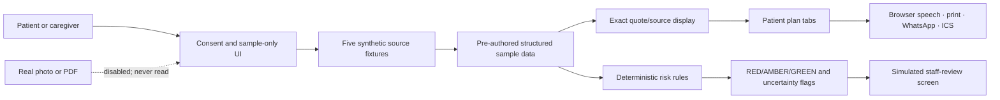

# DischargeDost

A mobile-first, multilingual reading companion prototype for hospital discharge instructions in India. The aim is to help patients and caregivers find what the source document actually says—and make uncertainty visible, not fill it in.

> **This build is a synthetic-data demo, not a medical product.** Real OCR, LLM extraction, translation services, PII processing, persistence, and clinician authentication are not implemented. Upload controls are intentionally inert. No real clinical advice or real-patient care plan is produced.

## Run it

```sh
pnpm install
pnpm dev
```

Open `http://localhost:3000`. To create a static production build, run `pnpm build`. Synthetic rule/fixture checks: `pnpm eval`.

## What works in this MVP

- Consent/limitations interstitial, English/Hindi output toggle, responsive patient view, synthetic sample 02, four care-plan sections, medicine timing columns, source line popovers, confidence/uncertainty signals, listen via browser speech synthesis, print/save PDF, WhatsApp checklist link, `.ics` follow-up reminder.
- RED triage and a side-by-side simulated reviewer route at `/review`. The reviewer can enter a fictional correction and observe it on the patient plan. **This is not nurse authentication, an authenticated PIN gate, actual hospital review, or permission to rely on a medical instruction.**
- Five synthetic fixtures in `samples/`, a deterministic risk helper in `src/lib/safety/rules.ts`, fixture-level evaluation, `SAFETY.md`.
- Upload is deliberately **not connected** to an extractor: picking a file only displays its filename and an explicit message that it stays in the browser, is not read, and is not uploaded.

## Architecture



## Safety model in this prototype

The patient view does not accept extracted real medical content. Each displayed medication, warning, and follow-up comes from fixed, fictional sample data, with a corresponding sample quote. A deterministic helper recognizes selected high-risk medicines and ambiguous dose flags. RED remains visible even after the synthetic reviewer demonstrates an edit. The emergency line—“In an emergency call 108 / go to the nearest hospital.”—is fixed UI copy. See [SAFETY.md](./SAFETY.md) before adapting the prototype.

## Evaluation (fixture checks only)

Run `pnpm eval`. These are unit/fixture measurements over the included synthetic sample—not an independent OCR, translation, usability, or clinical validation. They do not establish that any real-world discharge summary can be parsed safely.

| Metric | Fixture result | Interpretation |
|---|---:|---|
| Medicine names present in cardiac sample | 7/7 (100%) | Synthetic fixture label and literal names only |
| Dose/number integrity in displayed sample entries | 7/7 (100%) | Locked values in pre-authored data; ambiguous handwritten dose remains flagged |
| Sample quotes found in sample source | 9/9 (100%) | Deterministic exact-substring test |
| Deliberate ambiguity / high-risk signals flagged | 2/2 (100%) | Furosemide ambiguity and warfarin; fixture-level only |
| Translation number-token integrity | 7/7 (100%) | Pre-authored Hindi strings; not a back-translation test |
| End-to-end sample pipeline latency | Reported by `pnpm eval` | UI-only; no OCR/LLM or network extraction |
| Unsupported medical claims shown | 0 in fixture checks | Does not establish zero hallucinations in any future model |

No real-extraction precision/recall, real translation back-check, or supported clinical latency exists yet. The generated results from `pnpm eval` are printed as Markdown; update this table after running the script if timing differs.

### Original-summary vs DischargeDost reading-time test (protocol)

Recruit 3 adult volunteers who can read the chosen sample language. Use synthetic sample 02 only. Randomize whether each person first uses the original summary or the DischargeDost sample screen. Start a timer; stop when they have correctly listed all seven medicine names, doses *as written*, and the unclear item. Do not treat speed as a safety score; record wrong answers separately. Use a fresh participant for each independent timing. Do not use real medical records.

| Volunteer | Original summary (seconds) | DischargeDost (seconds) | Missing/incorrect items | Notes |
|---|---:|---:|---|---|
| 1 | — | — | — | Not yet run |
| 2 | — | — | — | Not yet run |
| 3 | — | — | — | Not yet run |

## Three-minute demo script

1. **0:00–0:30** — Open the home screen. Read the consent panel and explain that upload/extraction and storage are intentionally disabled.
2. **0:30–1:05** — Choose “I understand — open demo.” Show the sample progress, synthetic cardiac source, RED banner, seven medicine cards, exact source popover, and unresolved handwritten line.
3. **1:05–1:40** — Switch to warning signs. Point out the verbatim source and fixed 108 emergency reminder. Toggle Hindi; try “Listen” if the browser has a Hindi voice.
4. **1:40–2:15** — Open Staff review. Show the sample page beside the ambiguous handwritten line. Enter/confirm a **synthetic** clarification. Return to the patient plan and point out that RED and “not real clinical review” remain.
5. **2:15–3:00** — Demonstrate a WhatsApp share link (avoid sending it to a real group), print/save PDF, and download a follow-up `.ics`. End on `SAFETY.md`: this MVP does not process real documents or replace clinical review.

## Project map

- `src/App.tsx`, `src/style.css` — responsive patient and staff-review demo.
- `src/lib/samples.ts` — synthetic content, quote helper, reminder content.
- `src/lib/safety/rules.ts` — deterministic abbreviation and risk helpers.
- `samples/` — five fictional discharge-summary fixtures.
- `eval/run.mjs` — fixture-only smoke metrics.
- `SAFETY.md` — detailed limits and product safety gaps.

## Important gaps before any real-world use

No PDF/image ingest, OCR, redaction, data deletion lifecycle, LLM adapter, schema extraction, fuzzy grounding, production risk-review workflow, healthcare security review, back-translation, real staff authentication, delivery integration, or clinical evaluation is present. The files and visible medical content are invented strictly for a hackathon UI demo. Do not present this MVP as a clinical service.
